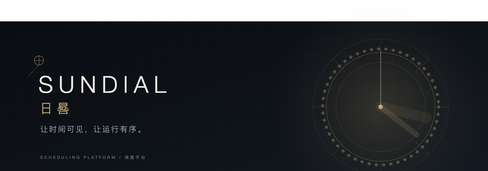
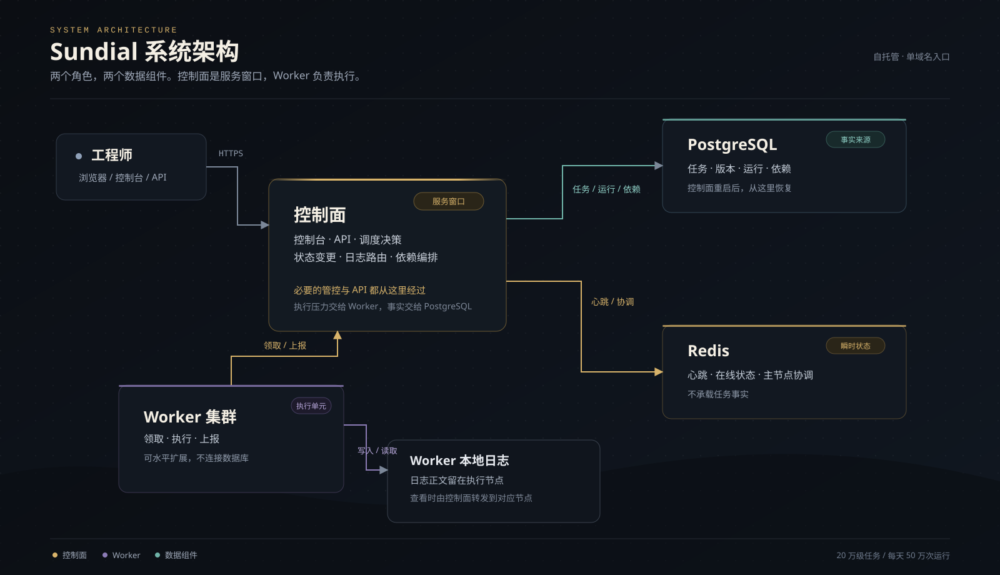
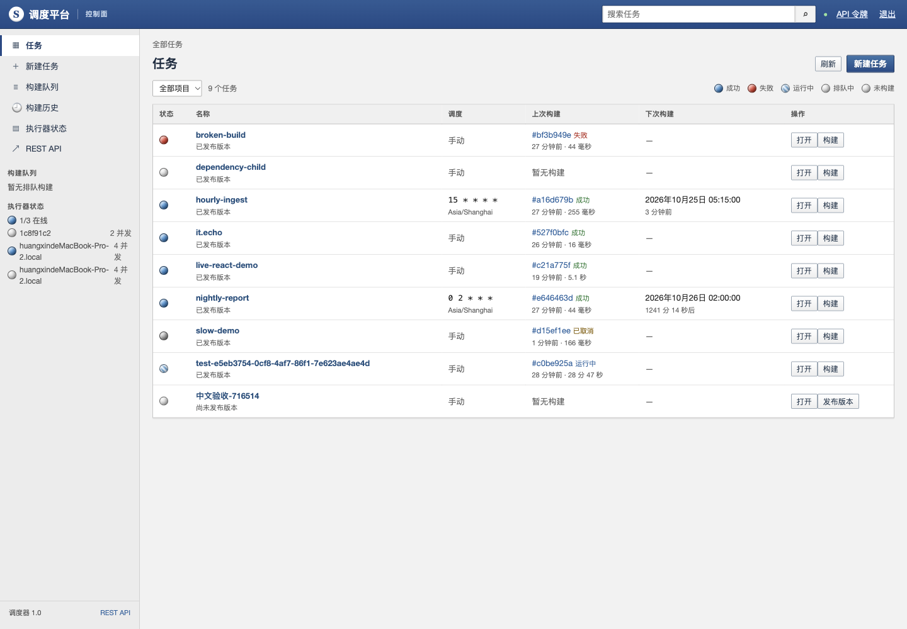
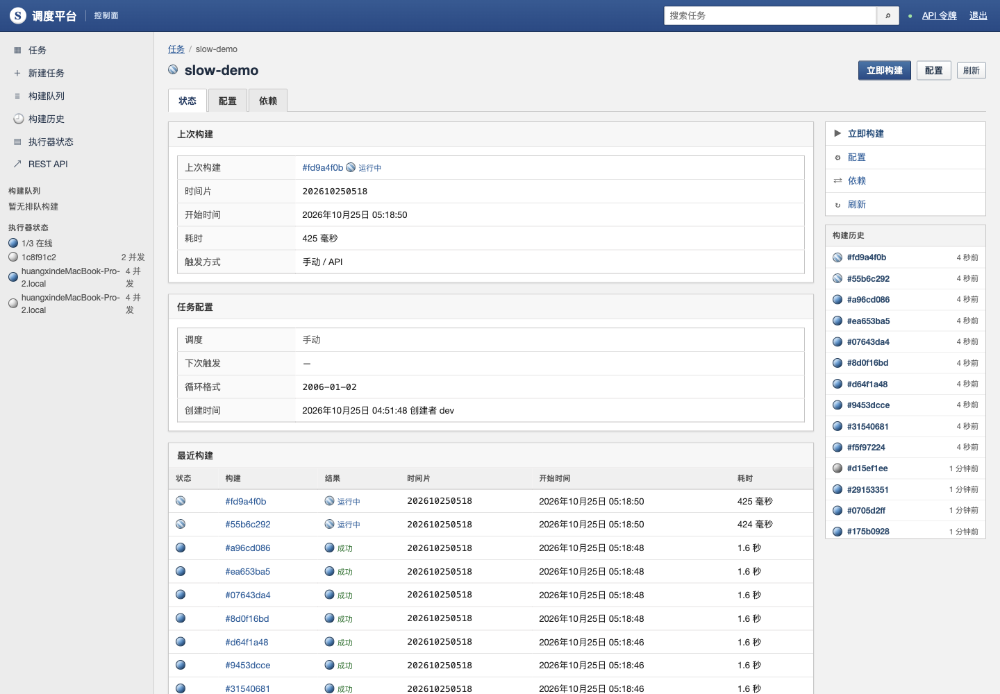
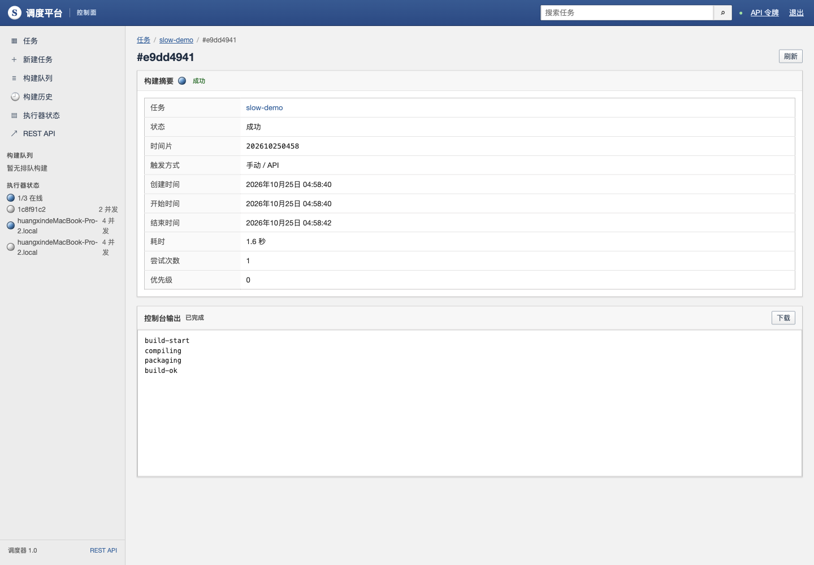
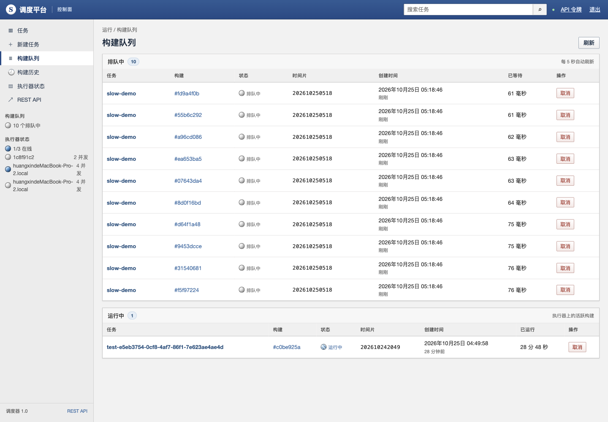

<p align="center">
  
</p>

<h1 align="center">Sundial · 日晷</h1>

<p align="center"><em>让时间可见，让运行有序。</em></p>

<p align="center"><sub>Go · PostgreSQL · Redis · React 19</sub></p>

---

> 日晷不制造时间，只让时间可见。

调度系统最好的状态，是让人忘记它的存在。

Sundial 是一个面向大规模作业的调度平台。它保留了 Jenkins 时代最好的那部分——一眼能看懂的任务、可追溯的历史、可以放心重跑的构建；同时把架构收得更简单，把稳定性留给系统，把从容留给使用它的人。

它不试图成为万能平台。它只做好一件事：在正确的时间，把正确的任务，交给正确的执行器，并留下清楚的记录。

## 更简单，所以更可靠

Sundial 的架构只有两层：**控制面**与 **Worker**。基础设施只保留两个组件：**PostgreSQL** 与 **Redis**。

控制面是整个系统的服务窗口：控制台、必要的 API、调度决策和状态变更都从这里经过。它不包办执行：任务压力交给 Worker，事实与历史交给 PostgreSQL，在线状态与协调交给 Redis。

Worker 是另一层：领取任务，执行，上报。它不连接数据库，也不等待中心逐条派发。

少一层协调，就少一类故障。简单不是少做事，而是把复杂留在系统内部，不让它溢到使用者的日常里。

## 架构一览

<p align="center">
  
</p>

| 角色 / 组件 | 职责 |
| --- | --- |
| **控制面** | 服务窗口：控制台、API、调度决策、状态变更、日志路由。 |
| **Worker** | 执行单元：领取任务、执行命令、产生并保存日志、上报结果。 |
| **PostgreSQL** | 事实来源：任务、版本、运行、依赖与状态；重启后从这里恢复。 |
| **Redis** | 瞬时状态：Worker 心跳、在线状态、主节点协调与短时缓存；不承载任务事实。 |

控制面负责“决定和发起”，Worker 负责“发生”，PostgreSQL 负责“记住”，Redis 负责“谁还在”。

日志的正文属于执行它的 Worker：Worker 采集、保存，查看时由控制面转发到对应节点。控制面只记录日志的位置和状态，不把日志正文变成自己的负担。

## PostgreSQL 与 Redis

**PostgreSQL 是事实来源。** 任务、版本、运行、依赖、状态都在这里落账。控制面重启后，账本还在，系统可以继续对账。

**Redis 是瞬时状态。** 它记录 Worker 的心跳、在线状态和主节点协调，也承担短时缓存。它让控制面知道“谁还在”，但不保存任务事实。

## 规模与稳定

Sundial 按 **20 万级任务、每天 50 万次运行** 的规模来设计。

增长时，优先增加 Worker。任务领取不需要中心逐条派发；控制面保留必要的管控和 API，执行压力随 Worker 扩展，控制面不必跟着变重。

正在运行的任务，不依赖控制面持续在线。Worker 本地执行、日志本地落盘；完成上报失败会重试并暂存，控制面恢复后继续。

**Master 重启、升级或短时故障，对正在运行的任务影响很低。** 控制面是服务窗口：必要的 API 和管控从这里经过，但执行压力分摊给 Worker，事实与历史交给 PostgreSQL，在线状态交给 Redis。窗口短暂关闭，工作仍在继续，恢复后继续对账。

高可用不是堆副本，而是让故障变得不重要。稳定也不是“永不失败”，而是故障发生时，影响被关在尽量小的范围里。

## 依赖，不是黑箱

任务依赖被组织成一条可读的时间线：上游成功，下游才触发；补数、重跑、失败恢复，都有清楚路径。

依赖关系不是藏在脚本里的约定，而是界面上可以展开的图。为什么触发、为什么等待、卡在哪一层，都能直接看见。

## 界面

控制台的气质，来自克制：密集但不拥挤，信息完整但不喧哗。它更像一张随时可以展开的工程图纸，而不是一块只会闪灯的仪表盘。

<p align="center">
  
  
</p>

<p align="center">
  
  
</p>

## 开始

需要 Go 1.23+、Node 22.12+ 和 Docker。

```bash
make db-up
make migrate
make web-build
```

启动控制面（API 与调度循环）：

```bash
make run-server
make run-scheduler
```

另开一个终端启动 Worker：

```bash
make run-worker
```

然后打开 <http://127.0.0.1:8080/ui/>。

当前为 P0/P1 实现，适合单租户、自托管场景。生产部署前，请先阅读部署文档中的边界说明。

## 文档

- [设计](DESIGN.md) — 系统如何工作，以及为什么这样工作
- [架构图](docs/architecture/sundial-architecture.svg) — 控制面、Worker、PostgreSQL 与 Redis 的关系
- [部署](deploy/README.md) — 单域名入口、systemd 与环境变量
- [开发记录](docs/aegis/plans/2026-10-25-scheduler-platform-development-outline.md) — 从想法到实现的完整路径
- [界面截图](docs/ui) — 控制台的日常视图

## 为什么叫日晷

日晷不制造时间，只把时间变成可以阅读的影子。

好的调度系统也不制造忙碌。它让每一件事在正确的时间发生，然后安静地退到背景里。

---

<p align="center"><sub>日晷不追赶时间。它只是把时间，放在该在的位置。</sub></p>
